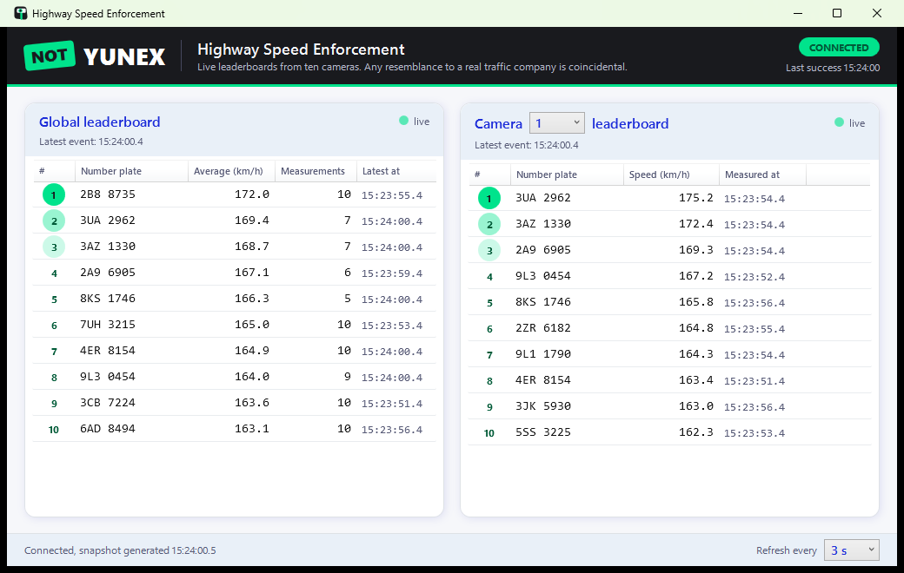
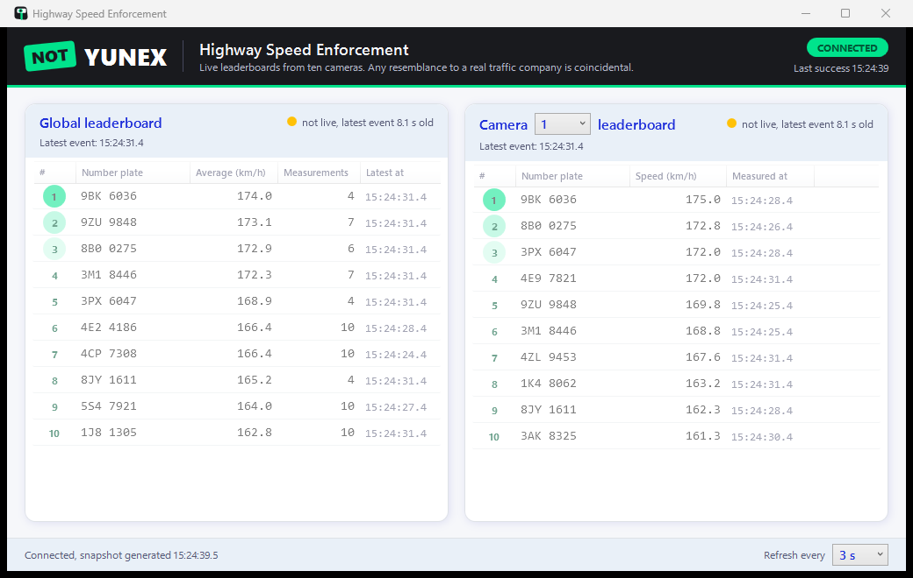
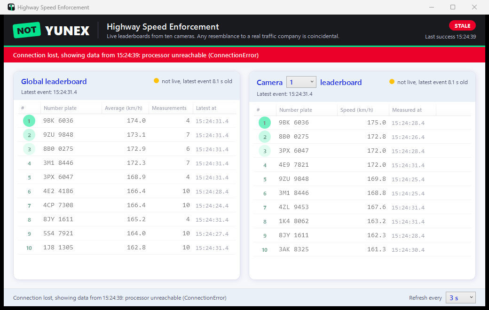
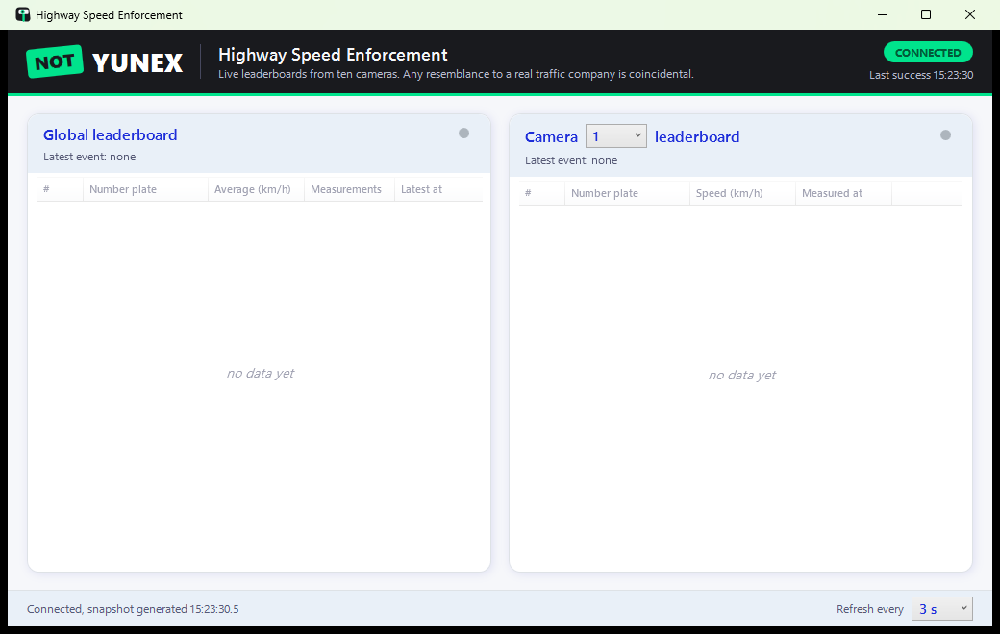
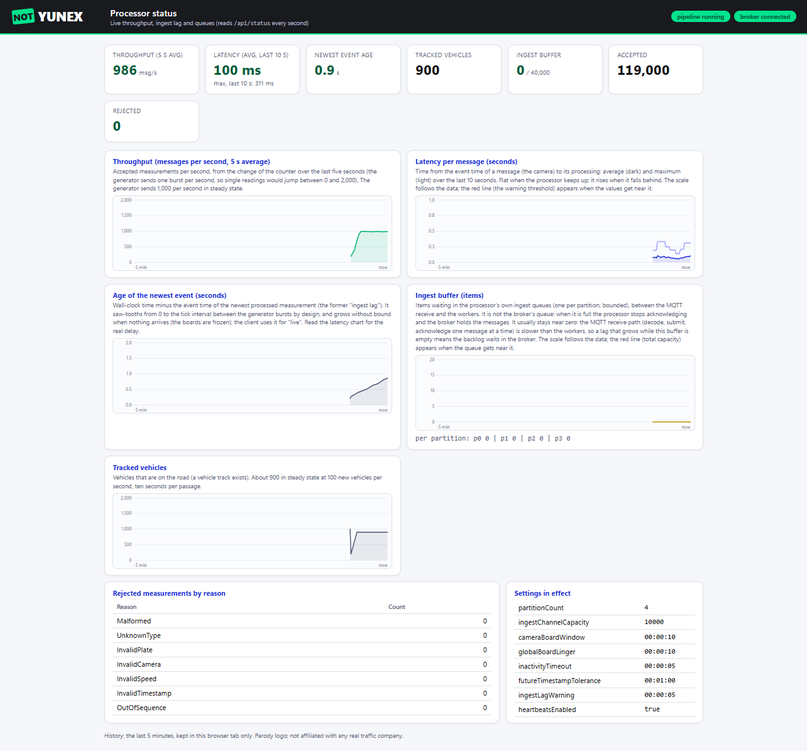

# Highway Speed Enforcement Pipeline

A prototype for a senior C# assignment: a telemetry **generator** simulates vehicles passing ten speed cameras, a
**processor** keeps live leaderboards from the telemetry and serves them over REST, and a WPF **client** shows them.
The assignment values design choices and structure over polish; the decisions are written down in `docs/`.

| Application | What it does | Runs as |
|---|---|---|
| `HighwaySpeedEnforcement.Generator` | Once per second creates 100 vehicles, advances every active vehicle one camera and publishes one measurement per vehicle and camera (plate, UTC ticks, speed in km/h, camera id) to the MQTT broker. Seeded runs are reproducible; plates are never reused. In a terminal it can be steered from the keyboard, see [Interactive console](#interactive-console). | console app on the host |
| `HighwaySpeedEnforcement.Processor.Api` | Subscribes to the broker, validates and orders measurements per vehicle, keeps the ten camera leaderboards (top 10 speeds per camera) and the global leaderboard (top 10 cumulative averages, at least 3 measurements), expires entries by event time, and serves `GET /api/traffic-snapshot`, `/api/status` and health endpoints. | .NET service in Docker |
| `HighwaySpeedEnforcement.Client.Wpf` | Polls the snapshot every 3 s and shows the global top 10 and the top 10 of a selected camera, marking boards that are not live and data that is stale (processor unreachable). | WPF app on the host (Windows) |

Data flow: `Generator --MQTT (QoS 1, JSON)--> Mosquitto broker --MQTT--> Processor --REST (JSON)--> Client`.

Screenshots of the client and of the processor status page are in the sections below. If your Markdown viewer does not show images, open
[`docs/screenshots.html`](docs/screenshots.html) in any browser.

## Build and test

Requirements: .NET SDK 10.0.x (pinned in `global.json`), Docker Desktop (broker, processor image, E2E tests), Windows for the client.

```
dotnet build Yunex.HighwaySpeedEnforcement.slnx                       # warnings are errors
dotnet test --solution Yunex.HighwaySpeedEnforcement.slnx              # unit, component and E2E tests (E2E needs Docker)
dotnet test --project tests/HighwaySpeedEnforcement.Unit.Tests        # fast tests only
dotnet format Yunex.HighwaySpeedEnforcement.slnx --verify-no-changes  # formatting check
```

The load test (1,000 messages/s for several minutes) runs only on request:
`dotnet test --project tests/HighwaySpeedEnforcement.E2E.Tests -p:TestingPlatformCommandLineArguments="--filter-trait Category=Load"`.

## Run the whole system

```
docker compose up -d --build                                                # broker on 127.0.0.1:1883, processor REST on http://127.0.0.1:8080
dotnet run --project src/Generator/HighwaySpeedEnforcement.Generator                  # runs until you stop it (Q or Ctrl+C); every run uses new plates
dotnet run --project src/Client/HighwaySpeedEnforcement.Client.Wpf
```

In a terminal the generator is interactive: keys `P`, `H`, `+`/`-`, `1`-`9`/`0`, `Q` change the traffic while it runs and a status
bar sits at the bottom (see [Interactive console](#interactive-console)); add `--Generator:Console:Interactive=false` to disable it,
and it is automatically off when the output is redirected.

Use `127.0.0.1`, not `localhost` (slow with Docker Desktop). The generator has **no run limit** by default and uses a random seed, with
the plates of earlier runs never reused (state file); for a bounded or reproducible run add
`-- --Generator:MaxTicks=120 --Generator:Seed=42` (a fixed seed repeats the same plates in every run). When the generator stops,
the boards freeze at their last event time and the client marks them *not live*. Stopping the processor (`docker compose stop processor`)
makes the client *stale* (last snapshot kept, red banner with the last success time); `docker compose start processor` recovers it.

### The client in its states

| Live (generator running) | Not live (generator stopped, boards frozen) |
|---|---|
|  |  |
| **Stale (processor unreachable, last data kept)** | **No data yet (processor just started)** |
|  |  |

### Changing settings

Every application reads its settings from `appsettings.json`, environment variables (`Section__Key`, double underscore) and,
for the console generator and the client, the command line (`--Section:Key=value`). Durations are `hh:mm:ss`; `Infinite`
is allowed where the table says so.

**Processor (runs in Docker).** Put the setting into the `environment:` block of the `processor` service in
`docker-compose.yml` (the file contains the commented examples), then recreate the container and check the effective values:

```yaml
    environment:
      ASPNETCORE_URLS: http://+:8080
      Mqtt__Host: broker
      Processor__CameraBoardWindow: "00:00:05"    # example: camera entries stay 5 s instead of 2 s
```

```
docker compose up -d processor                  # recreates the container with the new environment
curl http://127.0.0.1:8080/api/status           # the "settings" object shows what is in effect
```

The compose file ships with both processor windows at **10 s** (`Processor__CameraBoardWindow`, `Processor__GlobalBoardLinger`; the code defaults are 2 s and 3 s)
so that the boards change calmly between two client refreshes; comment the lines out to get the defaults back.

**Generator and client (run on the host).** Add `--Generator:...` after the `--` of `dotnet run` (the client takes
`--Client:...` or `Client__BaseUrl`), or set an environment variable such as `Generator__Seed=42`.

| Application | Setting | Default | Effect |
|---|---|---|---|
| Processor | `Processor__CameraBoardWindow` | `00:00:02` | How long a camera entry stays on its board; `Infinite` keeps the best 10 ever. |
| | `Processor__GlobalBoardLinger` | `00:00:03` | How long a completed vehicle stays on the global board; `0` or `Infinite` allowed. |
| | `Processor__InactivityTimeout` | `00:00:05` | Silence after which an in-flight vehicle is dropped from the global board. |
| | `Processor__PartitionCount`, `Processor__IngestChannelCapacity` | 4, 10000 | Parallel workers and the size of each ingest buffer. |
| | `Processor__HeartbeatsEnabled` | `true` | Whether camera heartbeats are processed. |
| | `Mqtt__Host`, `Mqtt__Port`, `Mqtt__Topic` | `broker` in compose, 1883 | Broker address; the topic must match the generator's. |
| Generator | `Generator:Seed` | random | Reproducible run; without it plates stay unique across runs through a state file. |
| | `Generator:MaxTicks`, `Generator:SpawnUntilTick` | none | Stop after N ticks; stop creating vehicles after tick N (traffic drains). |
| | `Generator:VehiclesPerTick` | 100 | Traffic volume per second (1000 = a 10x load burst). |
| | `Generator:DisabledCameras:0=7` | none | Simulate a dead camera (the others keep working, averages use the accepted measurements). |
| | `Generator:Heartbeats:Enabled=true` | false | Idle cameras send heartbeats, so a quiet camera's board empties instead of freezing. |
| | `Generator:Speed:BaselineKmh`, `DesiredStdDev`, `StepStdDev` | 130, 15, 3 | Speed model: the fleet's typical speed, spread between vehicles, change between cameras. |
| | `Generator:Mqtt:PublisherMode` | `PerCamera` | `PerCamera` (ten connections) or `SingleConnection`. |
| | `Generator:Mqtt:Host`, `Port`, `Topic` | `127.0.0.1`, 1883, `highway/telemetry/v1` | Broker address (use `127.0.0.1`, not `localhost`). |
| | `Generator:Console:Interactive` | `true` | `false` turns the interactive console off; it is used only in a real terminal (never when output is redirected). |
| Client | `Client__BaseUrl` (or `src/Client/HighwaySpeedEnforcement.Client.Wpf/appsettings.json`) | `http://127.0.0.1:8080` | Processor address. |
| | `PollInterval`, `RequestTimeout`, `LiveLagThreshold` | 3 s, 10 s, 3 s | Polling period (the status bar of the window also lets you switch it to 1, 2, 3 or 5 s while it runs); per-request bound; lag (`GeneratedAtUtc − LatestEventUtc`) above which a board is shown as not live. |

### Demo recipes

Generator commands (run after `docker compose up -d --build`; the client shows the effect within a few polls):

```
# calmer traffic around 110 km/h instead of 130
dotnet run --project src/Generator/HighwaySpeedEnforcement.Generator -- --Generator:Speed:BaselineKmh=110

# camera 7 is dead: its board stays empty, vehicles still complete, averages use the accepted measurements
dotnet run --project src/Generator/HighwaySpeedEnforcement.Generator -- --Generator:DisabledCameras:0=7

# traffic stops after 30 s and idle cameras send heartbeats: the boards drain to empty instead of freezing
dotnet run --project src/Generator/HighwaySpeedEnforcement.Generator -- --Generator:SpawnUntilTick=30 --Generator:Heartbeats:Enabled=true

# the same without heartbeats: the boards freeze at their last event time and the client marks them not live
dotnet run --project src/Generator/HighwaySpeedEnforcement.Generator -- --Generator:SpawnUntilTick=30

# 10x the traffic (10,000 messages per second)
dotnet run --project src/Generator/HighwaySpeedEnforcement.Generator -- --Generator:VehiclesPerTick=1000
```

With `Processor__CameraBoardWindow: Infinite` in the compose file the camera boards become "best ever" lists (only the 10
best entries per camera are kept).

### Interactive console

When the generator runs in a terminal (standard input and output not redirected), the keyboard changes the traffic while it
runs. Changes take effect at the next tick and are logged as `operator: ...`; a run in which no key is pressed is exactly as
reproducible as before.

| Key | Action |
|---|---|
| `P` | pause / resume new traffic: no new vehicles, the ones on the road finish |
| `H` | heartbeats on / off |
| `+` / `-` | more / fewer vehicles per tick: steps of 10 up to 100, of 100 above it (10 to 2,000), for example 90, 100, 200, 300 |
| `1`..`9`, `0` | switch camera 1 to 9, and 10 (`0`), off or on (an off camera emits nothing; vehicles still pass it) |
| `Q` | quit (like Ctrl+C: the running tick is completed first) |

The bottom three rows of the terminal are a fixed status bar (a separator, the status line, the key help); log lines scroll
above it in a compact one-line format instead of JSON. The status line looks like

```
tick 123 | traffic RUNNING | 100 veh/tick | heartbeats off | cameras off: 7 | broker connected | sent 12,345 | last tick 0.13 s | seed 42
```

Demos with the client open:

- `P` with heartbeats on (`H`): the road drains, idle cameras send heartbeats, the boards empty and stay *live*.
- `P` with heartbeats off: the boards freeze at their last event time and the client marks them *not live*.
- A camera switched off (for example `7`): only that camera's board freezes; the others keep moving.

The setting `Generator:Console:Interactive` is `true` by default and takes effect only when both streams are a terminal;
`--Generator:Console:Interactive=false` turns it off. With redirected or piped output (`> file`, the E2E tests, a
container) the generator behaves exactly as before: JSON logs, no keys, no bar. A terminal without ANSI support gets the
compact log lines and the keys, without the bar.

### Status page (throughput, lag, buffer)



Open `http://127.0.0.1:8080/ui` while the system runs. The page (one self-contained HTML file served by the processor, no
external scripts) reads `/api/status` every second and draws the last five minutes of: throughput (accepted messages per
second, averaged over five seconds), the latency per message (average and maximum), the age of the newest event (the former "ingest lag"), the ingest buffer and the tracked vehicles, plus the rejected counters by reason and the settings in effect.
The *ingest buffer* is the processor's own queue between the MQTT receive and its workers (one bounded queue per partition),
**not** the broker's queue: when it fills up the processor stops acknowledging and the broker holds the messages. A lag that grows
while the throughput stays flat means the processor falls behind; a lag that grows while the throughput is zero means that nothing
arrives (the boards are frozen).
The buffer normally stays near zero (measured: at most a few items at 6,000 messages per second, even with a queue capacity of 50): the MQTT
receive path (decode, submit, acknowledge) is slower than the board workers, so a lag that grows while the buffer is empty means that the
backlog waits in the broker, which the processor cannot see. The buffer fills only when the workers are the slower part.
**Latency** is measured per message (the time of its processing minus its own timestamp, averaged and maximized over ten seconds, and a
histogram `processor.ingest.latency`), so it stays flat while the processor keeps up. The *age of the newest event* (the old "ingest lag")
saw-tooths from 0 to the one-second tick between the generator bursts by design; the client uses it to decide "live".

Processor endpoints: `GET /api/traffic-snapshot` (the boards), `GET /api/status` (counters, ingest lag, broker state), `GET /ui` (status page),
`GET /health/live`, `GET /health/ready`.

## Design in brief

- **Transport (ADR-0001).** MQTT 3.1.1, QoS 1, Mosquitto in Docker: at-least-once, so a repeated message is rejected by the sequence rule (cameras of one
  vehicle must increase). A keyed stream with replay (Kafka API) is the documented next stage, not built.
- **Event time, not wall clock (ADR-0003).** Windows, linger and inactivity run on the measurement timestamps through watermarks (per camera and global).
  A silent input freezes the boards; the client decides "live" from `GeneratedAtUtc - LatestEventUtc`.
- **Concurrency (ADR-0003).** Per-plate partitioned workers with bounded channels and a lock per board; the content of the boards does not depend on how workers
  interleave. Model-based tests compare the ranked boards with a naive oracle over seeded random sequences.
- **Layers (ADR-0004).** Domain, Application, Infrastructure and a host per application; the dependency rule is enforced by architecture tests. The wire
  contracts belong to the processor (`Processor.Contracts`) and are checked against approved example files.
- **Tests.** About 620: unit, model-based, component (`WebApplicationFactory`), and end-to-end with Testcontainers (real broker, processor image, generator process).
  Every acceptance scenario `AC-xx` has a test (`pwsh tools/ac-coverage.ps1`). The window has no UI automation; the view models are tested without WPF.
- **Method.** The assignment's ambiguities, decisions, rules and designs were written down first (`docs/`, `CLAUDE.md`) and the components were implemented from
  per-component plans with deviation logs (`docs/design/*-implementation-notes.md`).

## Beyond the assignment

Everything here is documented as an extension and none of it changes the required behavior:
heartbeats (an optional message type) and the orphan timeout; validation with rejection counters, health and status endpoints, the status page and the latency
metric of the processor; configurable board windows (the assignment is ambiguous, AMB-01/02); in the generator seeded reproducible runs, Czech-like plates, a plate
state file (unique plates across restarts), one MQTT client per camera and the interactive console; in the client the stale and not-live marking, a selectable
refresh period and a parody "NOT YUNEX" look.

## Documentation

- `docs/assignment/` — the original assignment (PDF).
- `docs/assignment-ambiguities.md` — every ambiguity in the assignment, the decision taken and why.
- `docs/domain/` — glossary, business rules (`BR-xx`), domain model, acceptance scenarios (`AC-xx`, every test cites one).
- `docs/contracts/` — the MQTT telemetry and REST snapshot contracts with approved example files.
- `docs/adr/` — architecture decisions: transport, technology stack, concurrency and leaderboard structure, solution structure.
- `docs/design/` — the design of each component and its implementation notes (deviations, open questions);
  `docs/plans/` — the implementation plans; `docs/testing-strategy.md`.
- `CLAUDE.md` — working rules of the repository.

## Known limitations

- Tier 2 scope (`AMB-06`): state is in memory only. No durable recovery across a processor restart (the boards refill
  within a window after a restart; completed vehicles of the past are gone), no broker or state-store high availability,
  a single processor instance (partitioned workers inside one process), no rejection of old events.
- The client's *live* judgment compares the processor's clock with the cameras' event time, so it assumes the generator
  and the processor clocks agree (same machine or synchronized). The displayed lag is what the client computed.
- The processor rejects out-of-sequence and duplicate measurements per vehicle; a plate that reappears after Camera 10
  starts a new passage (`AMB-10`, newest passage wins). Camera gaps are tolerated and the average uses the accepted
  measurements only.
- The WPF window has no automated UI tests (view-model tests cover the behavior; a manual smoke run with screenshots
  covers the binding). The client is Windows only; everything else runs on any platform.
- The end-to-end tests need Docker and use real time (a real broker, the processor image and the generator process). On a heavily loaded machine an
  occasional timing-sensitive failure is possible (a fixture that starts late, a tick that takes longer); a rerun passes. The unit, model-based and component
  tests are deterministic (fake clock) and need no Docker.
- The processor takes MQTT messages one at a time (decode, submit, acknowledge): about 5 to 6 thousand messages per second were measured on the development
  machine, five times the assignment's 1,000. Beyond that a backlog builds up in the broker, where the processor cannot see it (the ingest buffer stays near
  zero while the latency rises).
- The broker queues up to 200,000 messages for an offline processor (`deploy/mosquitto/mosquitto.conf`); a longer outage loses the newest ones silently.
- Without messages the event clock stands still: the boards and the tracked vehicles stay frozen until the next message or heartbeat (by design, BR-LB-12).
- The "NOT YUNEX" logo is a parody wordmark made for this prototype. This project is not affiliated with, endorsed by or
  connected to Yunex Traffic or any other traffic company; the original assignment text is kept in docs/assignment/.
