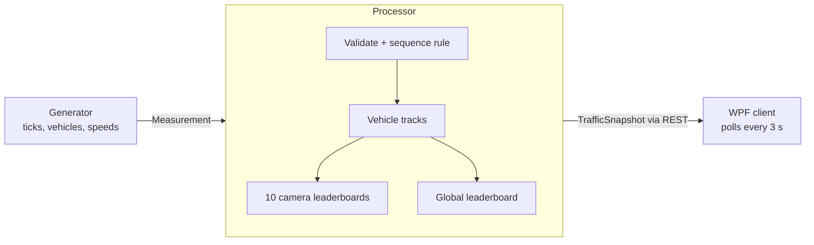
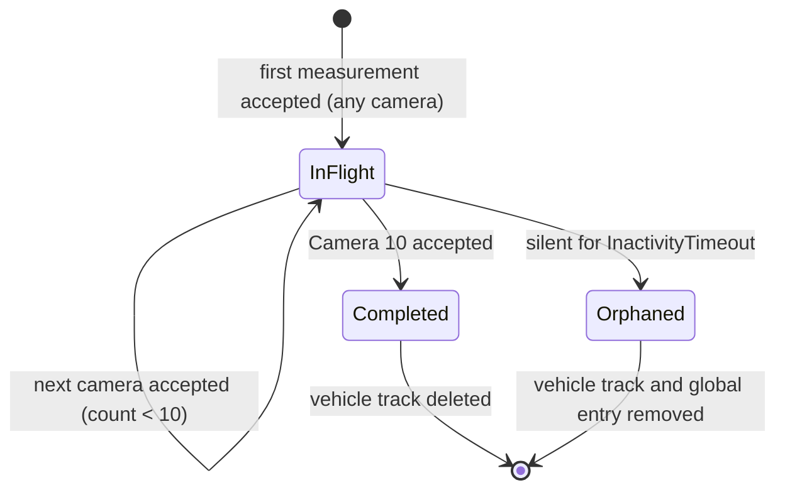
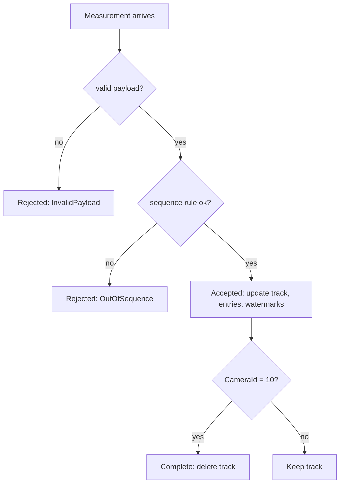

# Domain model

Technology-neutral. Describes what exists and how it changes, not how it is built (see ADRs for that).
Terms: `glossary.md`. Rules: `business-rules.md`.

## Data flow

## Concepts

| Concept | Kind | Identity / key | Holds | Lifetime |
|---|---|---|---|---|
| Measurement | value object | `(NumberPlate, CameraId)` | plate, timestamp, speed, camera | transient: processed once |
| Vehicle track | entity | `NumberPlate` | count, speed sum, last camera, last timestamp | first accepted measurement until Camera 10 or orphan timeout |
| Entry | value object | `(NumberPlate, board)` | plate, score, timestamp | until expiry or pruning |
| Leaderboard | ranked set of entries | camera 1–10, or global | live entries, watermark | process lifetime |
| Traffic snapshot | read model (DTO) | none | 10 camera boards, global board, `GeneratedAtUtc`, `LatestEventUtc` per board | one API response |

A **leaderboard** is the core concept. Both kinds share the same behavior, differing only in score and expiry:

| | Camera leaderboard | Global leaderboard |
|---|---|---|
| Score | `CurrentSpeed` of one measurement | cumulative average of a vehicle |
| Entries per plate | at most 1 | at most 1 (replaced on each measurement) |
| Entry can change | no (fixed) | yes while the vehicle is in-flight; fixed once completed |
| Leaves by | expiry after `CameraBoardWindow` | expiry after `GlobalBoardLinger` (completed), removal on orphan timeout (in-flight) |
| Watermark | newest timestamp at that camera | newest timestamp overall |

Capabilities a leaderboard needs: insert or replace an entry, remove an entry, expire entries against the watermark,
read the top 10 in rank order, and (optionally) prune dominated entries.

## Time and removal at a glance

**Watermark** is the board's own clock: the timestamp of the newest measurement it has seen. It moves only when new data
arrives, never with the wall clock. **Age** of an entry is `watermark − entry.Timestamp`. An entry is **live** while its age
is below its window or linger.

Three different things disappear, for three different reasons:

| What disappears | Trigger | Parameter | Compared against |
|---|---|---|---|
| A camera entry (expiry) | its age reaches the window | `CameraBoardWindow` | that camera's watermark |
| A completed vehicle's global entry (expiry) | its age reaches the linger | `GlobalBoardLinger` | global watermark |
| An in-flight vehicle: its track and global entry (orphaning) | its last measurement is that far behind | `InactivityTimeout` | global watermark |

Expiry concerns **entries on boards**. Orphaning concerns a **vehicle that went silent**. A vehicle that completes
normally never needs the timeout: its track is deleted at Camera 10 and only its entries age out.

Worked example, camera 5, `CameraBoardWindow` = 2 s. Measurements: A 150 km/h at t = 10, B 140 at t = 11, C 120 at t = 12.

- After C: watermark = 12. Ages: A = 2 (not below 2, expired), B = 1 (live), C = 0 (live). The board shows B, C.
- Silence: no more data. The watermark stays at 12, so B and C stay on the board, even ten minutes later (**freeze**).
  The board's `LatestEventUtc` = 12 tells the client how old the data is.
- New measurement D at t = 20: watermark jumps to 20, B and C both expire (ages 9 and 8), the board shows D only.

Orphan example, `InactivityTimeout` = 5 s. Vehicle V is accepted up to camera 6 at t = 6, then goes silent. Other vehicles
keep arriving; when the global watermark reaches 11, V's track and global entry are removed. Its earlier camera entries
age out through their own window as usual.

## Vehicle lifecycle

Global entry presence while a vehicle is in-flight: absent for counts 1–2, present and updated from count 3, kept as a
fixed completed entry for `GlobalBoardLinger` after completion.

## Measurement outcome

Rejected measurements change no state; they are counted and logged.

## Invariants

1. A plate has at most one vehicle track at a time.
2. A vehicle track's last camera only increases; its count is the number of accepted measurements and is at most the last camera (cameras may be missing).
3. A vehicle track exists only for in-flight vehicles; none for completed or orphaned ones.
4. A leaderboard presents at most 10 entries, in rank order, and they are the 10 best live candidates.
5. A plate appears at most once on any one leaderboard.
6. A global entry for an in-flight vehicle exists if and only if its count is at least 3.
7. Watermarks never decrease; they are stamped on each message in arrival order from valid measurements.
8. The final content of a board depends only on the valid measurements and their timestamps, not on processing speed or on how workers interleave.
